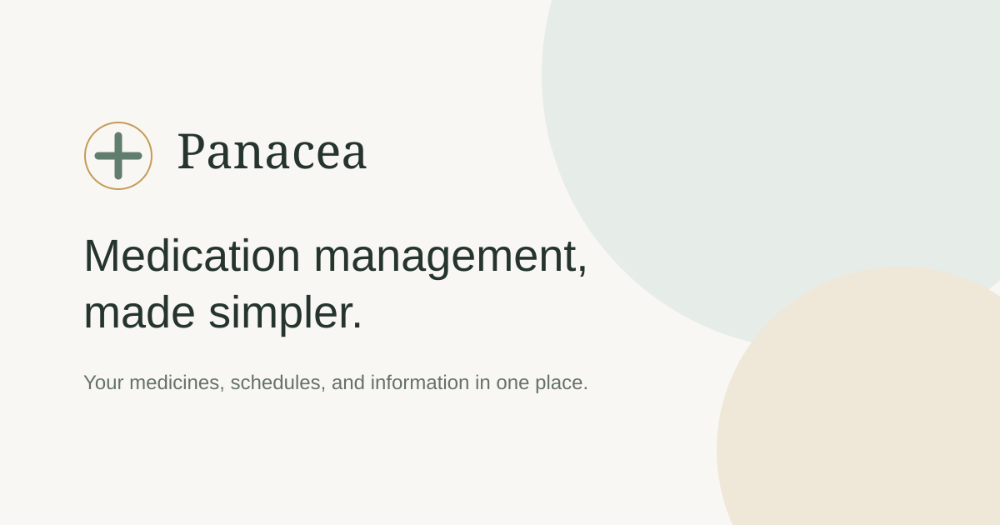
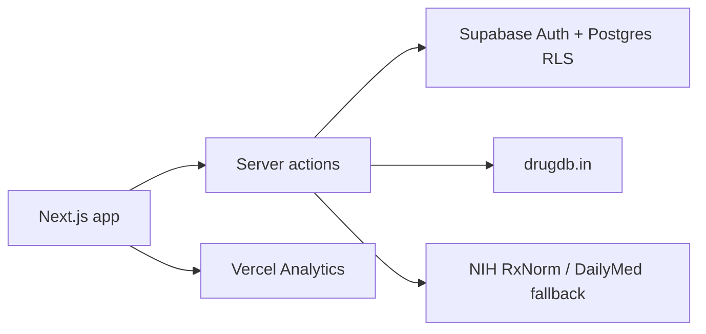

# Panacea

Panacea is a medication organizer built with Next.js, React, Tailwind CSS, and Supabase. It keeps a personal medicine library, schedules, dose history, barcode register, and medicine reference information together.

[Open the live demo](https://panacea-neon.vercel.app)

## Features

- Medicine library with add/edit, archive, expiry dates, and provider-linked details.
- Dose schedules, history, reminders while the browser is open, and undo.
- Camera barcode scanning and a private register for later manual assignment.
- Allergy records and ingredient comparisons; medicine information is educational and can be incomplete.
- Per-account data access through Supabase Row Level Security.

## Architecture

Barcode decoding runs in the browser with ZXing. Only a decoded value is sent to the server when the user saves a scan. Medicine lookup requests pass through authenticated server actions; successful reference data may be kept in the shared medicine cache.

## Setup

1. Install dependencies with `pnpm install`.
2. Create a Supabase project and apply migrations in `supabase/migrations/` in order.
3. Copy `.env.example` to `.env.local` and configure the required values.
4. Start locally with `pnpm dev` and open [http://localhost:3000](http://localhost:3000).

## Environment variables

| Variable | Required | Purpose |
| --- | --- | --- |
| `NEXT_PUBLIC_SUPABASE_URL` | Yes | Supabase project URL, exposed to the browser |
| `NEXT_PUBLIC_SUPABASE_PUBLISHABLE_KEY` | Yes | Supabase publishable key, protected by RLS |
| `SUPABASE_SECRET_KEY` | For shared cache writes | Server-only Supabase key; never expose with a `NEXT_PUBLIC_` prefix |
| `NEXT_PUBLIC_SITE_URL` | Recommended | Canonical URL used for metadata and sitemap |
| `NEXT_ALLOWED_DEV_ORIGIN` | Optional, development only | LAN host allowed for Next.js dev resources/HMR, such as a private IP address |
| `HEALTHPILOT_BASE_URL` | Optional | drugdb.in-compatible medicine information endpoint |
| `HEALTHPILOT_API_KEY` | Optional | Provider key when using a configured compatible endpoint |
| `NLM_API_CONTACT` | Optional | Contact value for NIH API requests |

## Development checks

| Command | Purpose |
| --- | --- |
| `pnpm lint` | ESLint |
| `pnpm typecheck` | TypeScript check |
| `pnpm test` | Vitest unit tests |
| `pnpm build` | Production build |

GitHub Actions runs all four checks on pushes and pull requests.

## Known limitations

- A barcode identifies a package code only; Panacea does not infer a medicine from it. Scans are stored for manual assignment.
- Browser reminders require the site to remain open and browser notifications to be permitted. Server-side delivery is not configured.
- Provider coverage varies. Medicine information, allergy comparisons, and food guidance can be incomplete and should be confirmed with a pharmacist or clinician.
- The app is not a diagnostic, prescribing, or emergency service.

## Privacy and terms

See the in-app [Privacy notice](https://panacea-neon.vercel.app/privacy) and [Terms of use](https://panacea-neon.vercel.app/terms). The policy text is general and should be reviewed for the deployment’s actual jurisdiction and practices.

## License

MIT. See [LICENSE](LICENSE).
